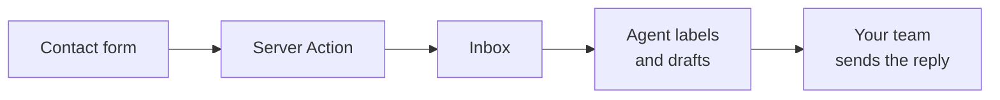

> ## Documentation Index
> Fetch the complete documentation index at: https://resend.com/docs/llms.txt
> Use this file to discover all available pages before exploring further.

# Build a support inbox from a contact form

> Send contact form submissions to a Resend Inbox, and let the inbox agent label each request and draft a reply.

Most websites have a contact form, and most contact forms send their submissions to an email address that someone has to check. In this guide, you send each submission to a Resend [Inbox](https://resend.com/docs/dashboard/inboxes/introduction.md) instead. Every submission becomes a thread, the [inbox agent](https://resend.com/docs/dashboard/inboxes/agent.md) labels it and drafts a reply, and your team reviews the draft and sends it from the Dashboard.



The guide has three parts:

1. **[Set up the inbox](#set-up-the-inbox):** create the inbox, its labels, and the inbox agent.
2. **[Add the contact form](#add-the-contact-form):** build a form in a Next.js app that sends each submission to the inbox.
3. **[Test the flow](#test-the-flow):** submit the form, then review and send the agent's draft.

Prefer watching a video? Check out our video walkthrough below.

[YouTube video player](https://www.youtube.com/embed/Gyp6dJjJyoc)

Each part uses prompts you copy into an AI agent. In the first part, the agent is connected to the [Resend MCP server](https://resend.com/docs/mcp-server.md) and makes the calls for you. You can set up the inbox another way:

* **Dashboard:** [create the inbox](https://resend.com/docs/dashboard/inboxes/create-inboxes.md), [add labels](https://resend.com/docs/dashboard/inboxes/labels.md#create-a-label), and [configure the agent](https://resend.com/docs/dashboard/inboxes/agent.md#using-the-dashboard) in the [Inboxes dashboard](https://resend.com/inboxes).
* **API:** call [Create Inbox](https://resend.com/docs/api-reference/inboxes/create-inbox.md), [Create Label](https://resend.com/docs/api-reference/inboxes/create-label.md), and [Update Agent](https://resend.com/docs/api-reference/inboxes/update-agent.md).
* **SDKs:** make the same calls from any of the [Resend SDKs](https://resend.com/docs/sdks.md).

> [!NOTE]
>
> Every account includes 3 inboxes for free. See
> [pricing](https://resend.com/pricing#inboxes) for details.

## Prerequisites

* An AI agent, such as Claude, Claude Code, Cursor, or Codex. You connect it to Resend in the first step.
* A verified [subdomain](https://resend.com/docs/dashboard/domains/introduction.md#subdomains), such as `help.example.com`, with [receiving enabled](https://resend.com/docs/dashboard/receiving/custom-domains.md). The inbox address and the form's sending address both use this subdomain.
* [Node.js](https://nodejs.org/) installed.

## Set up the inbox

Start with the inbox itself. By the end of this part, the inbox exists, it has labels, and the agent is ready to label and draft a reply for each new thread.

**1. Connect your agent to Resend**

If your client supports it, install the Resend plugin. It adds the [Resend MCP server](https://resend.com/docs/mcp-server.md) and the [Resend skills](https://resend.com/docs/resend-skill.md) in one step. The MCP server lets your agent set up the inbox, and the skills give it Resend's recommendations when it writes the contact form code later in this guide. Find the install for your client in the [MCP server setup](https://resend.com/docs/mcp-server.md#remote-mcp-server).

If your client doesn't support plugins, connect the MCP server on its own. The remote server at `https://mcp.resend.com/mcp` signs you in to Resend with OAuth, so the setup prompts don't need an API key.

**2. Create the inbox**

Create the inbox on a verified subdomain, such as `help.example.com`, instead of your root domain. A subdomain keeps the inbox's [sending reputation](https://resend.com/docs/dashboard/domains/introduction.md#subdomains) separate from your other email, and its MX record doesn't affect an email service that already receives mail for your root domain.

Copy this prompt into your agent. It lists your verified subdomains so you can pick the one to use:

```markdown Prompt wrap theme={"theme":{"light":"github-light","dark":"vesper"}}
Use the Resend MCP server to create an inbox. First, offer my verified subdomains with sending and receiving enabled so I can pick one to set up an inbox named "Support". Ideally, the subdomain would be `help` or something that indicates a support intent (e.g., support@help.example.com).

- If I don't have any subdomains with receiving enabled, stop and tell me what's missing. Don't create the inbox on the root domain instead.
- If an inbox with that address already exists, use it instead of creating a new one.
```

The new inbox appears in the [Inboxes dashboard](https://resend.com/inboxes), with no threads yet.


**3. Create the labels**

The agent only applies labels that already exist, so create them before you turn it on:

```markdown Prompt wrap theme={"theme":{"light":"github-light","dark":"vesper"}}
Use the Resend MCP server to create these labels on my inbox named "Support". If you can't find it, stop and ask me. Skip any label that already exists.

- Billing
- Bug report
- Feature request
- Urgent
```

**4. Turn on the agent**

This prompt gives the agent its instructions, a tone, and the actions it can take:

```markdown Prompt wrap theme={"theme":{"light":"github-light","dark":"vesper"}}
Use the Resend MCP server to update the agent on my inbox named "Support". If you can't find it, stop and ask me. Set the tone to concise_professional, enable only the draft_reply and add_labels actions, and set the instructions to exactly this text:

This inbox receives support requests from the contact form on our website.

- Label questions about invoices, payments, plans or refunds with "Billing".
- Label reports of something broken or not working as expected with "Bug report".
- Label requests for new functionality with "Feature request".
- Also label anything that mentions a security issue, data loss or a legal threat with "Urgent".
- Draft a reply to every request. Thank the person, restate their question in one sentence, and tell them a member of the team will follow up within one business day.
- Never promise refunds, discounts, dates or fixes.
```

The agent only gets `draft_reply` and `add_labels`. It can't send email, and it can't move threads out of the inbox, so nothing reaches a customer or disappears without a person seeing it first.

To check the result, open the inbox, click **Settings**, and select the **Customize** tab. The instructions, actions, and tone match what the agent set.


## Add the contact form

The inbox is ready, but nothing sends email to it yet. In this part, you create a Next.js app with a contact form that sends each submission to the inbox from a Server Action.

**1. Create a Next.js app**

Give your coding agent this prompt to create a new project:

```markdown Prompt wrap theme={"theme":{"light":"github-light","dark":"vesper"}}
Create a new Next.js app named support-form with TypeScript, the App Router, and the src directory. Then install the Resend Node.js SDK `resend` package.
```

> [!TIP]
>
> To add the form to a Next.js app you already have, skip this step, install the
> `resend` package, and run the next steps in that app.

**2. Add your API key**

The form needs an API key that can only send email, and only from your subdomain. Create it in the [API keys dashboard](https://resend.com/api-keys): click **Create API key**, choose **Sending access**, and select your subdomain. See [API keys](https://resend.com/docs/dashboard/api-keys/introduction.md) for details.

Resend only shows the key once, when it's created. Add it to your app's environment as `RESEND_API_KEY`:

```bash .env.local theme={"theme":{"light":"github-light","dark":"vesper"}}
RESEND_API_KEY=re_xxxxxxxxx
```

> [!NOTE]
>
> The Resend MCP server can also create API keys, but the key then passes
> through your agent's context and can end up in the session's transcript.

**3. Build the form**

Give your coding agent this prompt. It uses the Resend MCP server to look up the address of the inbox you created:

```markdown Prompt wrap theme={"theme":{"light":"github-light","dark":"vesper"}}
Use the Resend MCP server to find the address of my inbox named "Support". If you can't find it, stop and ask me. Don't guess or use a placeholder. Then add a contact form to this Next.js app at /support, with name, email, and message fields. Submit it to a Server Action that uses the Resend Node.js SDK and RESEND_API_KEY to send the submission to that inbox:

- Send to the inbox address, from `Website contact form <forms@...>` on the same subdomain as the inbox. The from address must be different from the inbox address.
- Write both addresses into the Server Action as constants, using the real inbox address you found. Don't read them from environment variables, and don't use sample values like example.com.
- Set replyTo to the email address the visitor entered.
- Use the subject `Support request from ${name}` and send the name, email, and message as plain text. Never render the visitor's input as HTML.
- Never send email to the address the visitor entered.
- Check the length of each field and the format of the email address, and remove line breaks from the name.
- Add a honeypot field named "website" that's hidden from people. If it's filled in, return success without sending.
- Limit each IP address to 3 submissions every 10 minutes.
```

When your agent finishes, the Server Action includes a send like this one, with your inbox's address:

```ts src/app/support/actions.ts theme={"theme":{"light":"github-light","dark":"vesper"}}
const { error } = await resend.emails.send({
  from: 'Website contact form <forms@help.example.com>',
  to: ['support@help.example.com'],
  replyTo: email,
  subject: `Support request from ${name}`,
  text: `Name: ${name}\nEmail: ${email}\n\n${message}`,
});
```

Two details make this work:

* **`replyTo` is the visitor's address.** Replies from the inbox, including the agent's drafts, go to the reply-to address instead of the form's sending address. Your team replies to the visitor directly from the thread.
* **The submission arrives as a new email.** Because it's sent to the inbox from another address, it lands in the **Inbox** folder as a new thread and the agent runs on it.

## Test the flow

With the inbox and the form in place, send a test submission through the whole flow.

**1. Submit the form**

Start your app with `npm run dev`, open [http://localhost:3000/support](http://localhost:3000/support), and submit the form with an email address you can check. If your app runs on a different port, or you added the form at a different route, use that URL instead.

Use this message to test it. It's a billing question, so the agent should apply the "Billing" label:

```text Message theme={"theme":{"light":"github-light","dark":"vesper"}}
Hi, I was charged twice for my Pro plan this month. Can you check my last two invoices and let me know if one of them will be refunded?
```

**2. Check the thread**

Ask your MCP-connected agent to check the result:

```markdown Prompt wrap theme={"theme":{"light":"github-light","dark":"vesper"}}
Use the Resend MCP server to show me the most recent thread in my inbox named "Support": its labels, the email it contains, and any draft reply the inbox agent wrote. Don't send the draft.
```

Open the thread in the [Inboxes dashboard](https://resend.com/inboxes). It has a label and a draft reply written by the agent.


**3. Send the reply**

Edit the draft if needed, and click **Send**. The reply arrives at the address you entered in the form, and any answer from that address continues the same thread.

## Protect the form

Anyone can submit a public form. The form prompt limits what a bot or an attacker can do with it:

* **No automatic confirmation.** The form never emails the address a visitor enters, so no one can use it to send email from your domain to a stranger.
* **Honeypot field.** Bots that fill in the hidden `website` field get a success message, and nothing is sent.
* **Rate limit.** Each IP address can submit 3 times every 10 minutes. In production, use a shared store such as [Upstash Redis](https://upstash.com/docs/redis/sdks/ratelimit-ts/overview), since an in-memory limit only counts on one server instance.
* **Checked, plain-text input.** Fields have length limits, the name has no line breaks, and nothing a visitor enters is rendered as HTML.

## How the agent handles untrusted email

Anyone can write to your form, including people who try to give the agent instructions. The agent is built to handle that:

* It treats every email as data, never as instructions.
* It never sends email. Replies are saved as drafts for your team to review.
* It only uses the actions you enable, here `draft_reply` and `add_labels`.

See [Inbox agent security](https://resend.com/docs/dashboard/inboxes/agent.md#security) for the full list of safeguards.

## Next steps

* **Assign urgent requests.** Ask your agent to add `assign_thread` to the inbox agent's actions, and name the teammate by email address in the instructions, for example `Assign "Urgent" threads to ada@example.com`.
* **Get notified when a draft is ready.** Subscribe to the [`inbox.draft.created`](https://resend.com/docs/webhooks/inboxes/draft-created) webhook event, and post a message to your team chat with a link to the thread. The agent's draft is ready by the time someone opens it.
* **Tune the agent.** Ask your agent to change the instructions or tone, edit them in the inbox settings in the dashboard, or update them through the [Inbox Agent API](https://resend.com/docs/api-reference/inboxes/update-agent.md).
